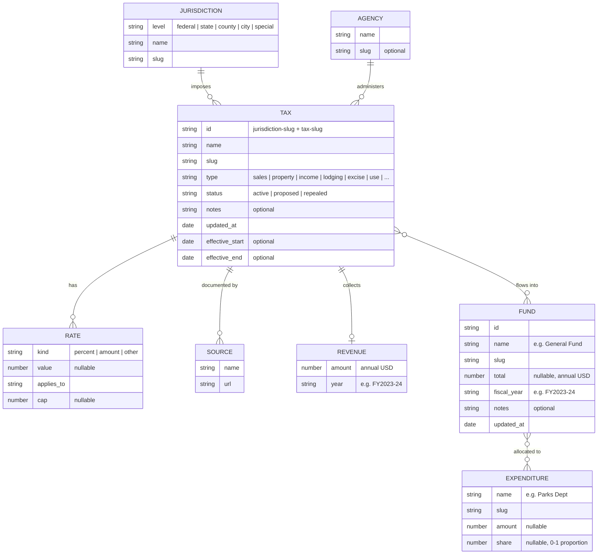

# Data Model

The current data model is document-oriented — each Tax is a self-contained JSON file with nested objects for jurisdiction, agency, rates, and sources. There is no relational database; Jekyll compiles all files into a single array.

## Entity Relationship Diagram

## Notes

- **Modeled in schema:** Tax (`schema/tax.schema.json`), Jurisdiction, Agency, Rate, Source, Revenue (fields on Tax), Funds (optional array on Tax linking to fund slugs)
- **Modeled in schema:** Fund (`schema/fund.schema.json`) with embedded Expenditures. Fund files live in `_data/funds/<jurisdiction>/`.
- **Tax → Fund link:** A tax's `funds[]` array references funds by slug, with optional `share` (proportion of revenue). This enables "where does this tax go?" on detail pages.
- **Fund → Expenditure link:** A fund's `expenditures[]` array lists spending categories with `amount` and/or `share`. This enables "what does this fund pay for?" in flow visualizations.
- Jurisdiction and Agency are embedded objects within each Tax JSON file, not standalone entities. If the project grows, extracting them into their own files (with Tax referencing by slug) would reduce duplication and enable jurisdiction-level pages.
